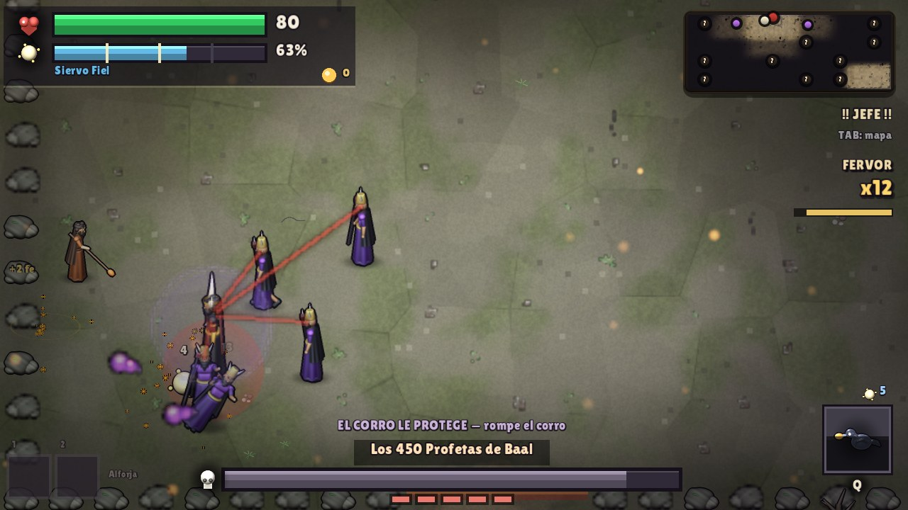
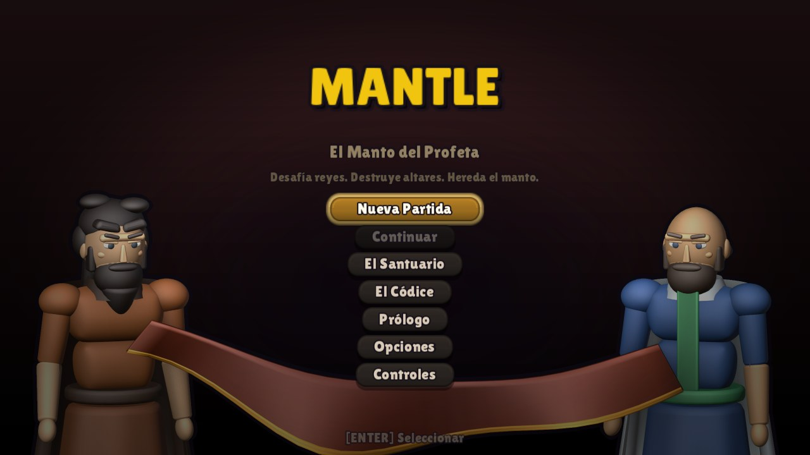
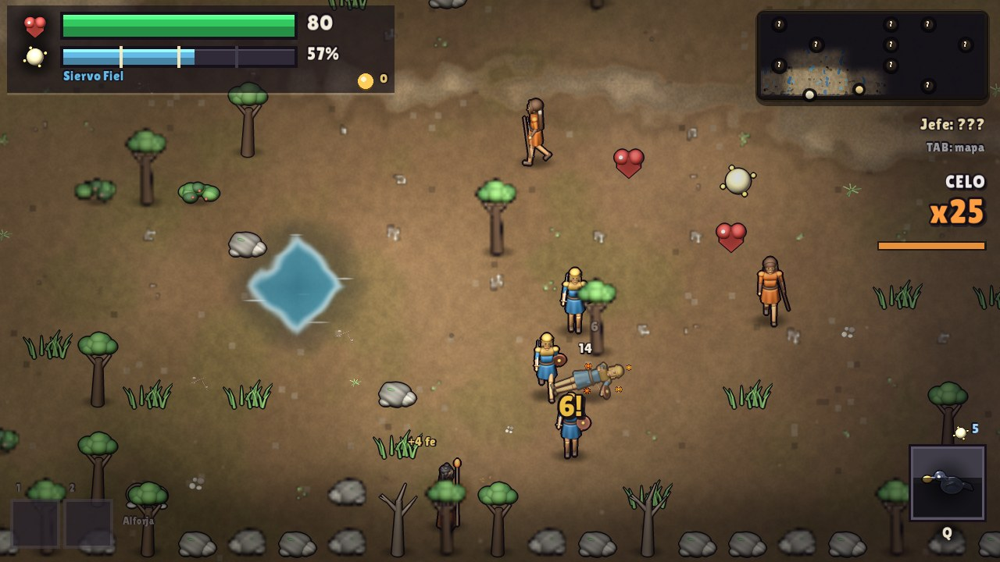
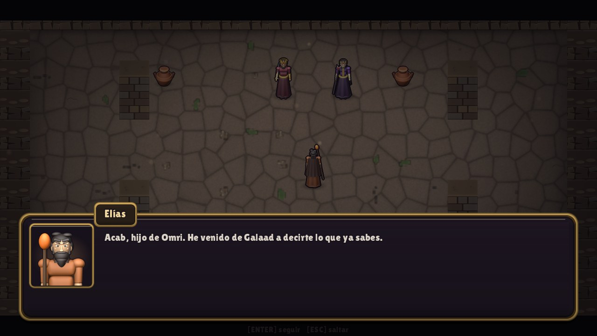
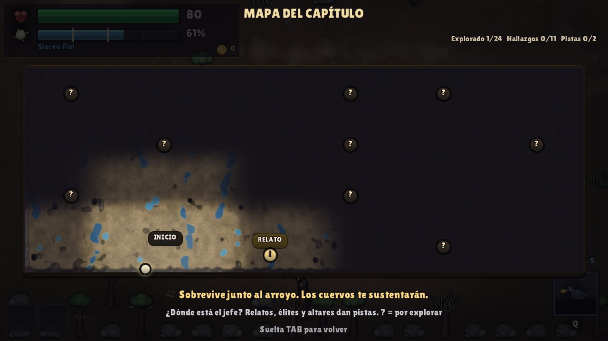

# MANTLE — The Prophet's Mantle

**[English](#english) · [Español](#español)**



| | |
|---|---|
|  |  |
|  |  |

---

## English

A top-down action roguelike based on the stories of Elijah and Elisha in 1–2 Kings.
Act I follows Elijah through five chapters, from the drought to the fire on Mount Carmel.
When he is taken up, his mantle passes to Elisha, and so do the items and faith you
gathered: Act II continues with him for five more chapters.

Written from scratch in C++17 on SDL3, with no game engine.

### The game

- **10 chapters and 10 bosses**, each chapter a large, scrolling outdoor zone with
  hand-placed interiors, secrets and side paths. World design follows *A Link to the Past*:
  the boundaries are cliffs, water and brush, and miracles double as exploration keys
  (fire burns brush and opens cracks, healing the waters dries pools, open eyes reveal
  what is hidden).
- **Faith** is the core resource: it powers the 10 miracles and scales across 6 tiers.
- **39 encounters** drawn from the biblical text, 22 items, 18 achievements, and a
  meta-progression hub (El Santuario) with 21 ranked upgrades.
- **Skill pays off.** Chain hits without getting touched to build *Zeal* (Fervor, Zeal,
  Burning Zeal): more damage, crits and faith while it lasts, and offerings when it cools
  down clean — one hit breaks it. Dash through an arrow or a boss attack at the last
  instant for a perfect dodge: slow motion, the dash back at once and a guaranteed crit.
- Scripture is quoted verbatim from public-domain translations: Reina-Valera 1909 in
  Spanish, King James Version in English. Enemies and events are checked
  against the text.
- Keyboard, mouse, gamepad and touch controls (twin virtual joysticks, left-handed mode,
  DPI-aware button sizes).

### Technical highlights

- **Data-oriented design.** Plain structs and a struct-of-arrays ECS with 512 entity
  slots. No inheritance, no virtual functions, no smart pointers.
- **SDL3 stack, statically linked:** SDL3, SDL3_image, SDL3_mixer (new `MIX_*` API) and
  SDL3_ttf, which is only used at startup to bake glyph atlases.
- **One CMake project for every target.** Windows builds with Visual Studio 2022; the
  Android Gradle project calls the same root `CMakeLists.txt` and produces an arm64 APK;
  a headless Linux build runs the test scripts in containers.
- **Every asset is generated inside the repo.** Characters and props are 3D models
  rendered to sprite sheets by a Blender Python pipeline (`tools/blender`). The 47 music
  tracks are original scores written as code and rendered by a synthetic orchestra in
  numpy/scipy (`tools/audio/orquesta`), without a single sample; the sound effects and
  the voices are synthesized with numpy too. The only third-party asset is the Lilita One
  font (SIL OFL).
- **Scripted autoplay for testing.** `--script` drives the game from a text file
  (move, attack, cast, jump to a chapter, spawn enemies, simulate touches, take
  screenshots), and each script's checks are read from the log. Over 50 scripts cover regressions, game feel,
  audio, both languages and touch input. The screenshots above were taken this way.
- **Versioned binary save** (v12) with migrations from every earlier version.

### Building

Requires CMake 3.22+ and a C++17 compiler. The SDL3 sources are expected in
`build/_deps/{sdl3,sdl3_image,sdl3_mixer,sdl3_ttf}-src`.

```bash
cmake -B build -S .
cmake --build build --config Release
```

The executable is written to the repository root (`MANTLE.exe` on Windows) so that the
relative `assets/` path resolves. For Android, `build_android.bat` builds a debug APK
(NDK 28, arm64-v8a).

Run a test script:

```bash
MANTLE.exe --script scripts/pulido_check.txt --shots shots/
```

### Status

In development. Windows and Android builds are playable from start to finish.

### License

© 2026 Armais. All rights reserved. The source is published for reference; it is not
licensed for reuse or redistribution. Credits for fonts, libraries and the Bible
translations used are in [`assets/CREDITS.md`](assets/CREDITS.md).

---

## Español

Un roguelike de acción con vista cenital basado en las historias de Elías y Eliseo de
1 y 2 Reyes. El Acto I sigue a Elías durante cinco capítulos, de la sequía al fuego del
Carmelo. Cuando es arrebatado, su manto pasa a Eliseo, y con él los objetos y la fe que
hayas reunido: el Acto II sigue con Eliseo cinco capítulos más.

Escrito desde cero en C++17 sobre SDL3, sin motor de juego.

### El juego

- **10 capítulos y 10 jefes.** Cada capítulo es una zona exterior grande que se recorre
  con la cámara siguiendo al profeta, con interiores, secretos y caminos que se desvían.
  El mundo sigue la gramática de *A Link to the Past*: los límites son acantilados, agua y
  matorral, y los milagros sirven también de llave (el fuego quema matorral y abre grietas,
  sanar las aguas seca charcas, abrir los ojos revela lo oculto).
- **La fe** es el recurso central: alimenta los 10 milagros y escala en 6 niveles.
- **39 encuentros** sacados del texto bíblico, 22 objetos, 18 logros y un lugar de
  meta-progreso (El Santuario) con 21 mejoras por rangos.
- **Jugar bien se nota.** Encadena golpes sin que te toquen y crece el *Celo* (Fervor, Celo,
  Celo Ardiente): más daño, críticos y fe mientras dura, y ofrendas si se enfría limpio — un
  golpe lo rompe. Atraviesa con el dash una flecha o el ataque de un jefe en el último
  instante y es una esquiva perfecta: cámara lenta, el dash de vuelta al momento y un
  crítico asegurado.
- Las citas bíblicas van literales y salen de traducciones de dominio público: la
  Reina-Valera 1909 en español y la King James en inglés. Enemigos y sucesos se
  contrastan con el texto.
- Teclado, ratón, mando y táctil (dos joysticks virtuales, modo zurdo y botones a tamaño
  físico según el DPI).

### Lo técnico

- **Diseño orientado a datos.** Structs planos y un ECS en struct-of-arrays con 512
  entidades. Sin herencia, sin funciones virtuales, sin punteros inteligentes.
- **SDL3 enlazado estático:** SDL3, SDL3_image, SDL3_mixer (la API nueva `MIX_*`) y
  SDL3_ttf, que solo se usa al arrancar para hornear los atlas de glifos.
- **Un solo proyecto CMake para todo.** Windows compila con Visual Studio 2022; el
  proyecto Gradle de Android llama al mismo `CMakeLists.txt` de la raíz y saca un APK
  arm64; una build de Linux sin pantalla corre los guiones de prueba en contenedores.
- **Todos los assets se generan dentro del repo.** Personajes y objetos son modelos 3D
  que un pipeline de Blender en Python renderiza a hojas de sprites (`tools/blender`). Las
  47 pistas de música son partituras originales escritas como código y las interpreta una
  orquesta sintética en numpy/scipy (`tools/audio/orquesta`), sin una sola muestra; los
  efectos y las voces también son síntesis propia con numpy. El único asset de terceros es
  la fuente Lilita One (SIL OFL).
- **Autoplay por guion para las pruebas.** `--script` maneja el juego desde un fichero de
  texto (moverse, atacar, lanzar milagros, saltar a un capítulo, sembrar enemigos, simular
  toques, hacer capturas) y deja en el log las comprobaciones que tienen que pasar. Hay más
  de 50 guiones para regresiones, tacto, audio, los dos idiomas y el control táctil. Las
  capturas de arriba están sacadas así.
- **Guardado binario versionado** (v12), con migración desde todas las versiones anteriores.

### Compilar

Hace falta CMake 3.22 o superior y un compilador de C++17. Las fuentes de SDL3 se buscan
en `build/_deps/{sdl3,sdl3_image,sdl3_mixer,sdl3_ttf}-src`.

```bash
cmake -B build -S .
cmake --build build --config Release
```

El ejecutable sale en la raíz del repositorio (`MANTLE.exe` en Windows) para que la ruta
relativa `assets/` funcione. Para Android, `build_android.bat` genera un APK de depuración
(NDK 28, arm64-v8a).

Correr un guion de prueba:

```bash
MANTLE.exe --script scripts/pulido_check.txt --shots shots/
```

### Estado

En desarrollo. Las builds de Windows y Android se juegan de principio a fin.

### Licencia

© 2026 Armais. Todos los derechos reservados. El código se publica para consulta; no
tiene licencia de reutilización ni de redistribución. Los créditos de la fuente, las
bibliotecas y las traducciones bíblicas están en [`assets/CREDITS.md`](assets/CREDITS.md).
